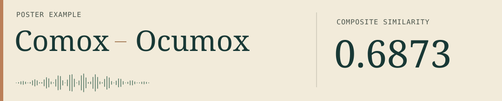
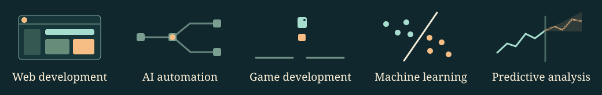

<picture>
  <source media="(max-width: 600px)" srcset="https://raw.githubusercontent.com/frenxpog1/frenxpog1/1b409029539989d6c08853bc7efaf183bf784a35/assets/cover-mobile.svg">
  
</picture>

<a href="#binisaya-calibrated-similaritya-cebuano-parameterized-editex-and-syllable-stress-pipeline-for-confusable-drug-name-detection">Research</a> &nbsp;·&nbsp; <a href="#selected-projects">Projects</a> &nbsp;·&nbsp; <a href="#off-the-clock">Off the clock</a>

I’m Frenz, from Tacloban City, Leyte, now studying in Cebu. When I think I’ve figured something out, I try it on the smallest example I can find. Then I look for one that breaks it.

<h2 align="center">Binisaya-Calibrated Similarity: A Cebuano-Parameterized Editex and Syllable-Stress Pipeline for Confusable Drug Name Detection</h2>

**If two medicine names look different on paper, could a Cebuano speaker still hear them as the same name?** My thesis partner and I built Likoliko to explore that question. We compare possible pronunciations and check how closely our rankings match pharmacists’ judgments.

<picture>
  <source media="(max-width: 600px)" srcset="https://raw.githubusercontent.com/frenxpog1/frenxpog1/1b409029539989d6c08853bc7efaf183bf784a35/assets/poster-example-mobile.svg">
  
</picture>

Read the pair aloud. How do you divide each name into syllables, and where do you put the stress? Those choices are two of the signals in our score. The number measures similarity under our rules. Estimating the chance of a medication error would require different evidence.

[Read the research](https://github.com/frenxpog1/Binisaya-Calibrated-Similarity) · [Inspect the ranking evaluator](https://github.com/frenxpog1/Binisaya-Calibrated-Similarity/blob/main/evaluate_rankings.py) · [Explore the Likoliko source](https://github.com/frenzteriod-hub/confusable-drugs)

How much of the pharmacist review was complete?

At the poster snapshot, reviewers had recorded **27,860 of 60,000 expected judgments** across 20,000 pairs. **696 pairs** had responses from all three reviewers. That distinction matters when comparing rankings on the same reviewed pairs.

[See the denominators and revision questions](https://github.com/frenxpog1/Binisaya-Calibrated-Similarity#worked-example-from-the-poster)

## Selected projects

| Build | Inside the repository |
| --- | --- |
| **[Philippine price tracker](https://github.com/frenxpog1/price-tracker-lazada)** | How a listing becomes a price-history chart, from a Python scraper through PostgreSQL to React. |
| **[Lost & Found](https://github.com/frenxpog1/Lost-Found-Web-App)** | A Next.js app for reporting a lost item or returning something you found. |

**My stack** &nbsp; Python · TypeScript · React · FastAPI · PostgreSQL · Git

Software interests in motion

<picture>
  <source media="(max-width: 600px)" srcset="https://raw.githubusercontent.com/frenxpog1/frenxpog1/c10257af0ea2dd78aa21afef5746015f03bf828c/assets/software-mobile.svg">
  
</picture>

<strong>Tech stack by project area</strong>

| Where I use it | Tools |
| --- | --- |
| Language and data work | Python, pandas, NumPy |
| Web interfaces | React, TypeScript, JavaScript, HTML, CSS |
| APIs and scraping | FastAPI, Node.js, Selenium, PostgreSQL |
| Coursework and utilities | C, PHP, Git |

## Off the clock

I play a lot of games. The ones I stick with give me a reason to trust a hunch, then make me rethink it a move later. With math, I usually want to draw the problem first. In chess, I’ll give up a pawn for a position that’s more interesting to play.

Strategy games, math and my two chess openings

<picture>
  <source media="(max-width: 600px)" srcset="https://raw.githubusercontent.com/frenxpog1/frenxpog1/69f2096d547eb060c01f8c1e590c62a1ea09f338/assets/interests-mobile.svg">
  
</picture>

