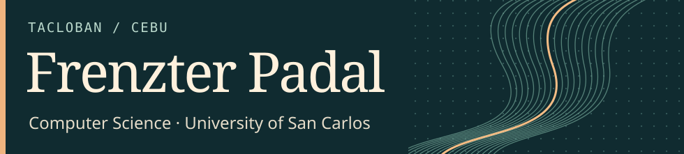

  

I’m Frenz, a CS student from Tacloban City, Leyte, now studying in Cebu. I like trying the smallest example I can think of. If my guess holds up, the fun part is finding the case where it breaks.

## Likoliko

**Which medicine names sound alike to a Cebuano speaker?** My thesis partner and I built Likoliko to compare several ways someone might pronounce the same name. Reviewers judge the pairs, which lets us see where our spelling, sound, and stress scores match what people hear.

[Research repository](https://github.com/frenxpog1/Binisaya-Calibrated-Similarity) · [Web app source](https://github.com/frenzteriod-hub/confusable-drugs)

## Software interests

<picture>
  <source media="(max-width: 600px)" srcset="https://raw.githubusercontent.com/frenxpog1/frenxpog1/c10257af0ea2dd78aa21afef5746015f03bf828c/assets/software-mobile.svg">
  
</picture>

**[Philippine price tracker](https://github.com/frenxpog1/price-tracker-lazada)** — I use Selenium to collect listings, PostgreSQL to store price changes, and React to plot the history.

**[Lost & Found](https://github.com/frenxpog1/Lost-Found-Web-App)** — A Next.js app for posting lost items and helping found ones get home.

<strong>Tech stack by project area</strong>

| Where I use it | Tools |
| --- | --- |
| Language and data work | Python, pandas, NumPy |
| Web interfaces | React, TypeScript, JavaScript, HTML, CSS |
| APIs and scraping | FastAPI, Node.js, Selenium, PostgreSQL |
| Coursework and utilities | C, PHP, Git |

## Off the clock

I play a lot of different games. Lately I’ve been into the ones where I can read a situation and trust a hunch. I think I’m pretty good at spotting the turning point, though sometimes it only clicks halfway through the next game.

<picture>
  <source media="(max-width: 600px)" srcset="https://raw.githubusercontent.com/frenxpog1/frenxpog1/69f2096d547eb060c01f8c1e590c62a1ea09f338/assets/interests-mobile.svg">
  
</picture>

