  

I'm Frenz, from Tacloban City, Leyte. I study computer science at the University of San Carlos in Cebu. MLBB is my strongest game. I like figuring out when to leave lane and where the next fight will happen. I’m into math, too. The curve above comes from running two sine waves at different speeds. Over the chessboard I play the Ruy Lopez as White and like giving up a pawn for quick development in the Scandinavian as Black.

Replay my Ruy Lopez opening

## On my desk

**Likoliko** · My thesis partner and I are working on a question we can actually hear: which medicine names sound alike when a Cebuano speaker reads them aloud? We compare several possible pronunciations for each name, then check our rankings against human judgments.

[Research repository](https://github.com/frenxpog1/Binisaya-Calibrated-Similarity) · [Web app source](https://github.com/frenzteriod-hub/confusable-drugs)

## Tech stack

| Where I use it | Tools |
| --- | --- |
| Language and data work | Python, pandas, NumPy |
| Web interfaces | React, TypeScript, JavaScript, HTML, CSS |
| APIs and scraping | FastAPI, Node.js, Selenium, PostgreSQL |
| Coursework and utilities | C, PHP, Git |

## Other builds

**[Philippine price tracker](https://github.com/frenxpog1/price-tracker-lazada)** — A Selenium scraper collects listings, PostgreSQL keeps the price history, and a React chart shows how the price moves.

**[Lost & Found](https://github.com/frenxpog1/Lost-Found-Web-App)** — A Next.js app for posting lost items and getting found ones back to their owners.
